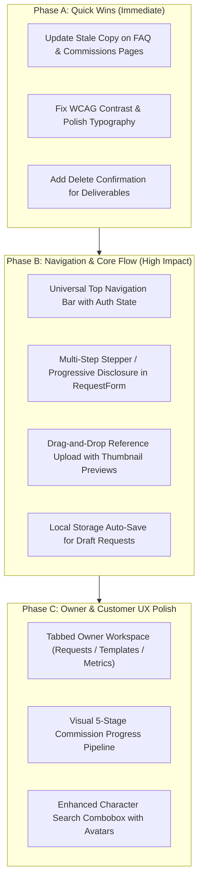

# UI/UX Comprehensive Audit & Improvement Plan

> **Project:** Hidden Lewd Studio Portal  
> **Date:** 2026-11-24  
> **Status:** Completed Audit & Roadmap

---

## Executive Summary

The **Hidden Lewd Studio** application has built a solid, functional backend foundation across Phases 1 through 4: secure authentication, RLS data isolation, atomic ACDB character autocomplete, transactional email notifications, customer request history, and owner workspaces with deliverable management.

However, the user experience and visual interface still exhibit traits of early MVP phases:

1. **Lack of Global Navigation & Header Identity:** Navigation is relegated entirely to the bottom footer, with no top navbar or persistent account widget.
2. **Monolithic Form Architecture:** The request intake form is a single long vertical scroll spanning 6+ dense cards without section progress indicators or accordion flow.
3. **Outdated Static Info Copy:** Policy/FAQ/Commissions pages contain stale Phase 1 preview disclaimers claiming requests and uploads are not yet active.
4. **Under-optimized Feedback & Micro-interactions:** Character autocomplete uses native `<datalist>` lacking loading spinners and avatars; reference file upload lacks drag-and-drop and image thumbnails; status changes lack quick-action triggers.

Below is an exhaustive breakdown of UI/UX findings categorized by domain, complete with high-impact recommendations and an actionable implementation plan.

---

## 1. Information Architecture & Navigation

### Current State

- The header is an inline `<header class="brand-header">` that only exists on `index.astro`.
- Subpages (`/requests/`, `/owner/`, `/faq/`, `/commissions/`, etc.) have no common header; some have a lone `← Back to the request portal` link, while `/requests/` and `/owner/` have no top back-link or navbar.
- All navigation links are clustered at the bottom of the page in `<footer class="site-footer">`.
- User account status (signed in as `email` vs sign in CTA) is rendered only inside `RequestForm.tsx` (the "Account" section) or in `RequestHistory.tsx`.

### Identified Issues

| Severity   | Issue                              | Impact                                                                                                                                             |
| ---------- | ---------------------------------- | -------------------------------------------------------------------------------------------------------------------------------------------------- |
| **High**   | No persistent top navigation bar   | Users browsing legal, policy, or requests pages cannot navigate between sections without scrolling down to the footer.                             |
| **High**   | Fragmented Authentication Presence | If a customer signs in on `/requests/` or `/`, there is no universal user badge showing their logged-in state or easy 1-click logout across pages. |
| **Medium** | "My requests" visibility           | Only appears in the footer and inside the form account section when signed in. New or returning users often overlook it.                           |

### Recommendations

1. **Universal Sticky/Floating Top Navbar:**
   - Add a fixed/sticky top navigation bar in `BaseLayout.astro`:
     - **Left:** Brand logo / text mark ("Hidden Lewd Studio") linking to `/`.
     - **Center/Nav Links:** `Request`, `My Requests`, `Commissions`, `Gallery`, `FAQ`.
     - **Right:** Dynamic Auth Pill (`Sign In` button when guest; Avatar / Nickname / Tier badge + dropdown with `My Requests`, `Owner Workspace` (if role=owner), `Sign Out` when authenticated).
2. **Breadcrumbs / Back-navigation on Subpages:**
   - Provide consistent top breadcrumbs on `/owner/` and `/requests/` for context.

---

## 2. Visual Design, Typography & Accessibility (a11y)

### Current State

- Palette: Primary Dark `#0e0f13`, Cards `#161820`, Inner `#1e212b`, Borders `#2b3040`. Accents: Pink `#ff3366`, Cyan `#00d2ff`.
- Typography: System font fallback `Inter, ui-sans-serif, system-ui`.
- Icons: Standard Unicode emojis (`🔐`, `📋`, `👥`, `🏷️`, `🎨`, `✓`, `🎤`, `🖼️`, etc.).

### Identified Issues

| Severity   | Issue                                  | Impact                                                                                                                                                 |
| ---------- | -------------------------------------- | ------------------------------------------------------------------------------------------------------------------------------------------------------ |
| **Medium** | Emojis as UI iconography               | Emojis render inconsistently across Windows, macOS, Android, and Linux, often looking childish or misaligned with the sleek neon dark cyber aesthetic. |
| **Medium** | WCAG AA Color Contrast on Pink Buttons | White text on `--accent-pink` (`#ff3366`) yields a contrast ratio of ~3.8:1, failing the 4.5:1 minimum threshold for regular text under WCAG 2.1 AA.   |
| **Low**    | Typography font loading                | Relies on system-installed Inter. If missing, falls back to default sans-serif, causing subtle layout shifts and varied letter spacing.                |

### Recommendations

1. **Modern Iconography:**
   - Replace raw text emojis with lightweight SVG icons (e.g., Lucide React or inline SVGs) for section headers, status badges, and action buttons.
2. **Color Contrast Fix:**
   - Adjust `--accent-pink` to `#e62b5c` or darken gradient endpoints to ensure white text meets >4.5:1 contrast, or use bold 700+ weights for large button text.
3. **Web Font Integration:**
   - Self-host or embed `@fontsource/inter` (or Google Fonts) for consistent typography across all operating systems.

---

## 3. Customer Intake Flow (`RequestForm.tsx`)

### Current State

- The form is a continuous single page with 6 cards:
  1. Account
  2. Commission request (Supporter info, Shinobi rank, Category)
  3. Cast selection (Character count, randomizers, autocomplete slots)
  4. Concept & scene details (Tags, interview questions, story briefing)
  5. Artistic direction (Reference files upload, credit, creative freedom)
  6. Confirmations (Adult age, policy checkboxes)
  7. Submit / Review button triggering receipt modal.

### Identified Issues

| Severity   | Issue                                      | Impact                                                                                                                                                                             |
| ---------- | ------------------------------------------ | ---------------------------------------------------------------------------------------------------------------------------------------------------------------------------------- |
| **High**   | Cognitive overload & scroll fatigue        | Filling out the entire form on mobile requires scrolling over 2,500px. Users cannot gauge how much is left.                                                                        |
| **High**   | No local draft auto-saving                 | If a supporter is writing a detailed 3,000-character story briefing or custom scene and accidentally refreshes, loses network, or closes the tab, all inputs are lost.             |
| **Medium** | Reference upload lacks preview & drag-drop | Customers only see a native file input with a list of file names. They cannot preview their uploaded reference images before submission to ensure they selected the right files.   |
| **Medium** | Autocomplete UX for characters             | Uses native `<datalist>`, which provides poor mobile keyboard integration, no character franchise thumbnails, and no visual loader while debounced ACDB proxy queries are running. |
| **Medium** | Supporter Tier / Rank clarity              | Asking "What is your current rank?" without context can confuse newcomers who don't know the difference between Chunin, Jounin, or Kage.                                           |

### Recommendations

1. **Progressive Disclosure / Multi-step Stepper:**
   - Group the form into 3 or 4 clear steps with a top progress bar:
     - **Step 1: Identity & Tier** (Account, Supporter Nickname, Rank, Category)
     - **Step 2: Cast & Concept** (Characters, Pose/Setting or Story Briefing)
     - **Step 3: Direction & References** (Visual references, Creative freedom, Credit)
     - **Step 4: Review & Submit** (Interactive summary, confirmation checkboxes, submit)
2. **Local Storage Draft Preservation:**
   - Automatically persist form inputs (nickname, platform, concept, tags, briefing) in `localStorage` under `hls_request_draft`. Restore smoothly when returning.
3. **Modern File Upload Dropzone:**
   - Implement a stylish drag-and-drop zone with instant thumbnail previews, file size indicators, and one-click remove buttons for each reference image.
4. **Custom Autocomplete Dropdown:**
   - Replace `<datalist>` with a custom accessible combobox displaying:
     - Character name & franchise
     - Subtle loading spinner during live search
     - ACDB attribution badge on external suggestions

---

## 4. Customer Request History (`RequestHistory.tsx`)

### Current State

- Lists all customer requests with status badges, collapsible cards, character lists, brief metadata, reference images, customer updates, and finished deliverables.

### Identified Issues

| Severity   | Issue                                          | Impact                                                                                                                       |
| ---------- | ---------------------------------------------- | ---------------------------------------------------------------------------------------------------------------------------- |
| **Medium** | Linear status text vs visual progress pipeline | The status is shown as a standalone pill (`accepted`, `in_progress`). Users cannot see where they are in the entire journey. |
| **Low**    | Non-image deliverable styling                  | Deliverables that are `.zip`, `.rar`, or text documents render as plain text without file-type visual icons.                 |

### Recommendations

1. **Visual Status Pipeline:**
   - Render a 5-step milestone bar:  
     `Submitted` ➔ `In Review` ➔ `Accepted` ➔ `In Progress` ➔ `Completed`  
     Highlighting the current stage and showing timestamps for completed steps.
2. **File Type Icons & Direct Download:**
   - Add clear badges/icons for archive deliverables (`.zip`/`.rar`), image sets, and text documents.

---

## 5. Owner Workspace (`OwnerDashboard.tsx`)

### Current State

- Top section: Statistics & Email Templates editor with iframe preview.
- Bottom section: Split-view with left list (paginated at 20/page, search + status filter, CSV export) and right detail view.

### Identified Issues

| Severity   | Issue                                                | Impact                                                                                                                                                                                      |
| ---------- | ---------------------------------------------------- | ------------------------------------------------------------------------------------------------------------------------------------------------------------------------------------------- |
| **High**   | Email template editor dominates vertical viewport    | The email template management box takes up ~600px of vertical space above the request list. The owner has to scroll past the email template editor every time they want to manage requests! |
| **Medium** | Two-step status update                               | Selecting a status in a dropdown and then clicking "Update status" is clunky.                                                                                                               |
| **Medium** | Dangerous actions lack explicit confirmation dialogs | Deleting a deliverable deletes immediately without a confirmation prompt or undo.                                                                                                           |

### Recommendations

1. **Workspace Tabs:**
   - Split the Owner Workspace into 3 dedicated tabs:
     - **Tab 1: Request Queue** (Main daily workflow: list, filters, search, detail, status, deliverables)
     - **Tab 2: Email Templates** (Template configuration, subject/body editor, test delivery)
     - **Tab 3: Overview & Metrics** (Breakdown by tier, status counts, monthly summary)
2. **Quick Status Action Buttons:**
   - In request details, show contextual action buttons (e.g., "Accept Request", "Begin Work", "Mark Completed") instead of an unselected dropdown.
3. **Confirmation Modal for Deletions:**
   - Add a confirm modal before deleting a finished deliverable.

---

## 6. Static Information Pages

### Current State

- `commissions.astro`, `faq.astro`, `gallery.astro`, `terms.astro`, `privacy.astro`, `contact.astro`.

### Identified Issues

| Severity   | Issue                         | Impact                                                                                                                                                                                                                           |
| ---------- | ----------------------------- | -------------------------------------------------------------------------------------------------------------------------------------------------------------------------------------------------------------------------------- |
| **High**   | Outdated Phase 1 preview copy | `faq.astro` and `commissions.astro` explicitly claim: _"Commission intake is not open... creates only a local demo summary... cannot upload references."_ This directly contradicts the functioning app and confuses real users! |
| **Medium** | Gallery placeholder           | Currently just 2 sentences of placeholder text.                                                                                                                                                                                  |

### Recommendations

1. **Update Copy to Match Production State:**
   - Update `commissions.astro` to outline real supported tiers, categories, and delivery workflow.
   - Update `faq.astro` to explain the intake process, supporter verification, private reference uploads, and deliverable access.
2. **Showcase Gallery Preview:**
   - Add a curated grid of sample studio artworks with lightbox previews to showcase quality and inspire commission ideas.

---

## Prioritized Implementation Roadmap

