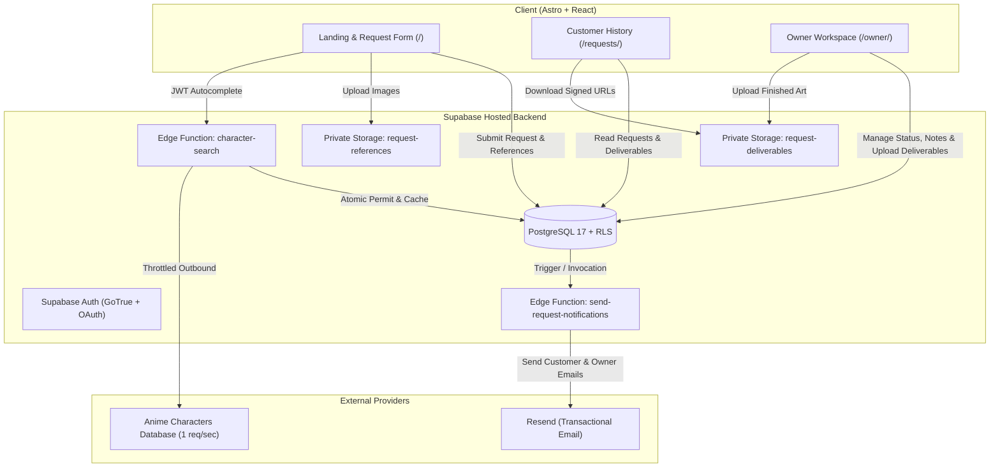

# Hidden Lewd Studio — Complete Work Summary (Phases 1–4)

> **Document Version:** 1.0  
> **Status:** Completed through Phase 4 and Sprint 3.9  
> **Date:** 2026-11-24

---

## 1. Executive Milestone Overview

Hidden Lewd Studio is a full-stack commission and supporter request management system built with **Astro**, **React**, **Tailwind CSS**, and **Supabase** (Postgres, Row Level Security, Auth, Storage, Edge Functions).

Phases 1 through 4 are complete and deployed to hosted production:

- **Phase 1:** Foundation, responsive dark-mode portal, local character catalog, review receipt generator, and policy documentation.
- **Phase 2:** Secure request intake, Supabase Auth integration, private reference image storage, server-side transactional emails (Resend & Mailpit).
- **Phase 3 (Sprints 3.1–3.9):** Authenticated customer request history, server-managed owner authorization, full owner workspace, audit status transitions, internal staff notes, request planning (due date/priority), CSV export, immutable email templates, and finished deliverable upload/download access.
- **Phase 4:** Safe Anime Characters Database (ACDB) proxy via Edge Functions with atomic global 1 req/sec rate limiting, PostgreSQL concurrency permits, private caching, request coalescing, and automated compliance testing.
- **Phase 5 (Payments):** Intentionally deferred pending merchant account and content policy eligibility reviews.

---

## 2. Architecture & Data Flow



---

## 3. Detailed Phase & Sprint Breakdown

### Phase 1: Foundation & Static Experience

- Responsive Astro/React frontend configured with dark cyberpunk aesthetic (`#0e0f13`, `#ff3366`, `#00d2ff`).
- Client-side intake form with Shinobi rank gating (Genin through Kage) and request categories (Interview, Single Illustration, Image Set, Quick Story Event).
- Character cast selection, tag randomizers, adult confirmation, and commission policies.
- Legal & policy pages: Terms of Service, Privacy Policy, Prohibited Content, FAQ, Contact.

### Phase 2: Secure Authenticated Intake

- **Supabase Integration:** Provisioned local and cloud Supabase projects.
- **Authentication:** Password sign-up/in, magic links, password reset, and Google/Discord OAuth.
- **Schema & RLS:** `profiles`, `requests`, `request_characters`, `request_references`, and `request_status_history`.
- **Private Storage:** `request-references` bucket restricted strictly to object creators and server-managed owners.
- **Email Notifications:** Protected `send-request-notifications` Edge Function routing through Resend in production and Mailpit locally.

### Phase 3: Customer History, Owner Workspace & Deliverables

- **Sprint 3.1 (Customer History):** `/requests/` page showing only authenticated user's requests, details, and 1-hour signed reference image previews.
- **Sprint 3.2 (Owner Authorization):** Server-managed `raw_app_meta_data.role = 'owner'` authorization model (never user-editable metadata).
- **Sprint 3.3 (Owner Dashboard):** Server-verified `/owner/` workspace with search, status filtering, and request inspector.
- **Sprint 3.4 (Communications Streams):** Separate immutable `customer_updates` (visible to customer and owner) and `internal_notes` (owner-only).
- **Sprint 3.5 (Status Transition Controls):** Server-enforced valid transition machine (`submitted` ➔ `in_review` ➔ `accepted` ➔ `in_progress` ➔ `completed` / `cancelled`) with PostgreSQL triggers.
- **Sprint 3.6 (Request Planning):** Owner-only due date and priority assignment (`low`, `normal`, `high`, `urgent`).
- **Sprint 3.7 (Pagination & Export):** 20 requests/page client pagination and sanitized CSV export excluding private storage paths.
- **Sprint 3.8 (Email Templates):** In-database editable email templates with immutable version history, live iframe previews, placeholder validation, and test sends.
- **Sprint 3.9 (Finished Deliverable Access):** Private `request-deliverables` storage bucket and `request_deliverables` database table. Owners upload finished art, variants, archives, and stories directly in `/owner/`; customers securely download them with expiring signed URLs from `/requests/`.

### Phase 4: ACDB Character Search Integration

- **Server-Side Proxy:** Edge Function `character-search` with strict JWT requirement.
- **Atomic Concurrency Control:** Shared PostgreSQL limiter (`reserve_acdb_request`) enforcing the hard 1 request per second rule across all edge instances.
- **Smart Caching & Coalescing:** Private cache table (`character_search_cache`) and in-flight request deduping (`character_search_inflight`).
- **Compliance & Attribution:** Prominent ODbL attribution and links to Anime Characters Database.
- **Testing Gate:** Network-isolated handler tests (`tests/acdb/handler.test.mjs`) and disposable Postgres limiter tests (`tests/acdb/limiter.sh`).

---

## 4. Applied Database Migrations

| Timestamp / Filename                                  | Scope & Tables Created                                                                       |
| ----------------------------------------------------- | -------------------------------------------------------------------------------------------- |
| `20261117194631_phase2_request_intake.sql`            | `profiles`, `requests`, `request_characters`, `request_references`, `request_status_history` |
| `20261118134401_request_notification_deliveries.sql`  | `request_notification_deliveries`                                                            |
| `20261118164530_remember_profile_request_details.sql` | Remembers nickname, platform, shinobi rank in profile                                        |
| `20261119175904_backfill_profile_request_details.sql` | Backfill script for profile request metadata                                                 |
| `20261119180911_phase3_owner_authorization.sql`       | Owner RLS policies based on `raw_app_meta_data.role`                                         |
| `20261119221851_phase3_request_communications.sql`    | `customer_updates` and `internal_notes` tables                                               |
| `20261119224234_phase3_owner_status_transitions.sql`  | Transition enforcement trigger & status history logging                                      |
| `20261119232152_phase3_request_planning.sql`          | `request_planning` (due dates, priorities)                                                   |
| `20261119235159_phase3_email_templates.sql`           | `email_templates` and `email_template_versions`                                              |
| `20261120092326_phase4_character_search_cache.sql`    | `character_search_cache` and `character_search_inflight`                                     |
| `20261120120000_acdb_request_interval.sql`            | `acdb_request_clock` and atomic limiter RPCs                                                 |
| `20261123150000_request_deliverables.sql`             | `request_deliverables` table & private bucket storage policies                               |

---

## 5. Verification Baseline & Test Commands

Every commit and pull request enforces:

```sh
npm run format:check   # Prettier verification
npm run lint           # ESLint analysis
npm run check          # Astro & TypeScript type checking
npm run test:acdb      # Network-isolated ACDB proxy test suite
npm run build          # Static 10-page build generation
```
